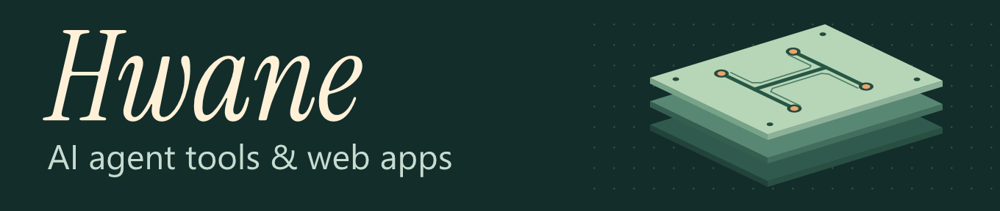

## AI 에이전트 도구

**[Nobellist](https://github.com/Kimuhwan/Nobellist)** 
“일정 조율 도구에 돈을 낼 사람이 있을까?” 같은 질문에서 출발합니다. 가장 약한 가정과 그 가정을 검증할 첫 실험, 성공·실패 기준을 정리하는 Python CLI입니다. [일정 조율 도구 예제](https://github.com/Kimuhwan/Nobellist/blob/HEAD/examples/startup_validation.md)

**[Agent Call Governor](https://github.com/Kimuhwan/Agent-Call-Governor)** 
Python 앱에서 에이전트 호출을 감싸면 같은 작업을 다시 요청할 때 실행 전에 걸러냅니다. 어떤 요청을 허용했는지는 SQLite에 기록합니다. [한국어 사용법](https://github.com/Kimuhwan/Agent-Call-Governor/blob/HEAD/README.ko.md)

## 웹 프로젝트

- **[꼬물꼬물 · 호기심 숲](https://github.com/Kimuhwan/AiHackaThon_Ggomul)** — 아이가 날씨에 관해 질문을 고르고, 식물을 돌보고, 물에 뜨는 물체를 관찰합니다. 보호자는 아이가 남긴 발견을 다시 볼 수 있습니다.
- **[전남대 공지 모아보기](https://github.com/Kimuhwan/jnu-events)** — SW중심사업단과 AICOSS의 공지를 한곳에 모았습니다. 키워드로 검색하고 게시판별로 추려볼 수 있습니다.

**브라우저에서 바로 보기**　[자연의 미학 · 객실 둘러보기](https://webbasemodelhwane.vercel.app/)
